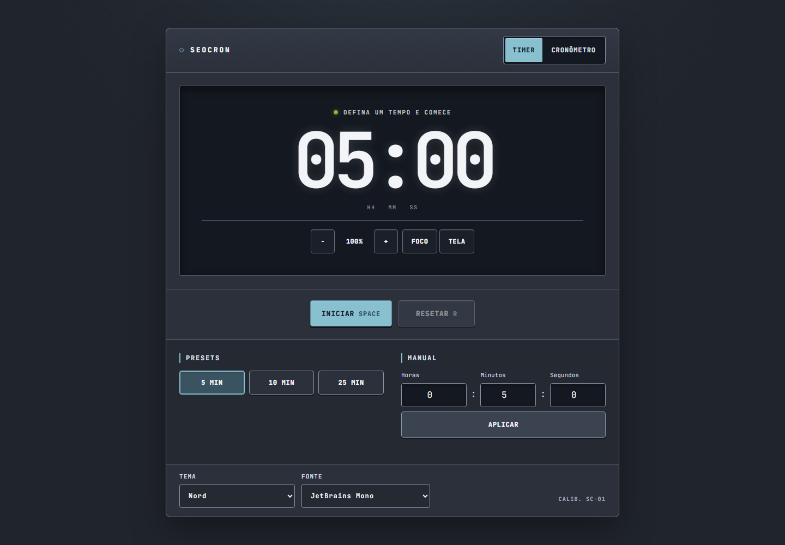
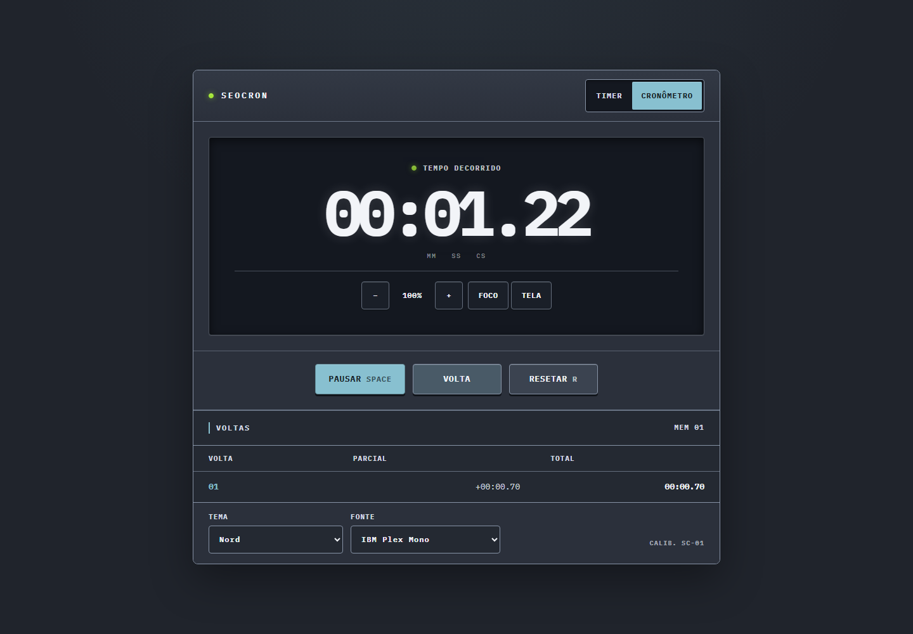
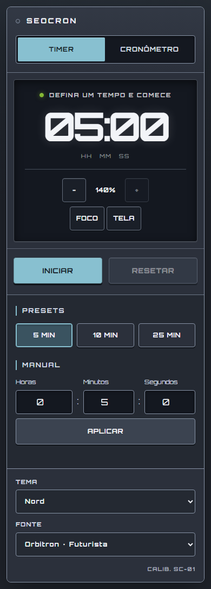
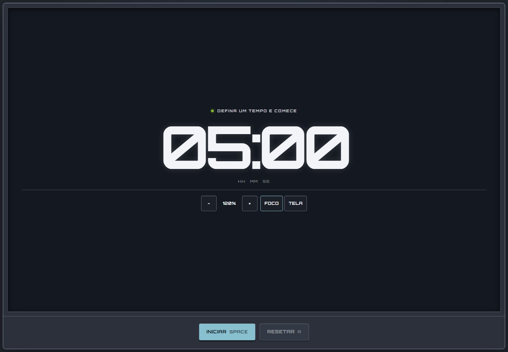

# seocron

Timer e Cronômetro em uma SPA estática, acessível e privada. Não há backend, tracking nem persistência no navegador; todo estado termina ao recarregar ou fechar a aba.

[Abrir aplicação](https://seocron-ashen.vercel.app/) · [CI](https://github.com/seocodes/seocron/actions/workflows/ci.yml) · [Contexto](./docs/PROJECT_CONTEXT.md) · [Guia de engenharia](./docs/GUIA_DE_ENGENHARIA.md) · [Backlog](./docs/BACKLOG.md) · [MIT](./LICENSE)

  

## Funcionalidades

- Timer com presets de 5, 10 e 25 minutos e entrada manual.
- Cronômetro com voltas e tempos parciais.
- Contagem derivada de timestamps reais, sem acumular ticks de intervalo.
- Escala do mostrador em 80%, 100%, 120% ou 140%, compartilhada entre os modos.
- Modo foco e tela cheia independentes, com fallback seguro.
- Wake Lock enquanto a contagem está ativa.
- Dez temas e seis fontes locais: JetBrains Mono, Space Mono, IBM Plex Mono, Orbitron, VT323 e DSEG7.
- Atalhos desktop: `Space` inicia ou pausa; `R` reseta o modo ativo.
- Layout sem overflow a partir de 320 px, título da aba em tempo real e estado apenas na memória.

## Modos e telas

  
  

  

## Requisitos

- Node.js 24.15+.
- npm.
- HTTPS no ambiente publicado para Screen Wake Lock e algumas políticas de fullscreen.

## Comandos

| Comando                      | Finalidade                                      |
| ---------------------------- | ----------------------------------------------- |
| `npm run dev`                | servidor local com hot reload                   |
| `npm run typecheck`          | validação TypeScript sem emissão                |
| `npm run lint`               | análise estática                                |
| `npm run test`               | testes unitários e de componentes               |
| `npm run test:coverage`      | testes e relatório com mínimos de cobertura     |
| `npm run test:e2e`           | build e E2E nos três navegadores                |
| `npm run test:e2e:chromium`  | E2E focado no Chromium                          |
| `npm run quality:budget`     | limites de JavaScript, CSS e fontes             |
| `npm run quality:lighthouse` | três medições locais do Lighthouse              |
| `npm run build`              | typecheck e build estático em `dist/`           |
| `npm run verify`             | formatação, tipos, lint, testes, build e bundle |
| `npm run verify:full`        | `verify` mais E2E em Chromium, Firefox e WebKit |

## Arquitetura em resumo

React e TypeScript rodam sobre Vite. Os motores de Timer e Cronômetro ficam em hooks separados da apresentação. Intervalos apenas solicitam renderização; diferenças de `Date.now()` são a fonte real do tempo.

Tema, fonte, escala, foco, voltas e contagens vivem em state React. Recarregar restaura os padrões. Nenhuma Web Storage, cookie, API remota ou fonte externa é usada em runtime.

Integrações de navegador são isoladas em hooks com detecção de suporte, fallback e cleanup: Fullscreen, Wake Lock, título e atalhos. Tokens CSS semânticos mantêm os temas desacoplados dos componentes.

A explicação completa, incluindo fluxo de dados, decisões e limites, está em [Contexto do projeto](./docs/PROJECT_CONTEXT.md). Para ler o código acompanhado de conceitos e testes, use o [Guia de engenharia](./docs/GUIA_DE_ENGENHARIA.md).

## Qualidade

Cada PR executa jobs paralelos e obrigatórios:

- `Verify`: formatação, tipos, lint, testes e build;
- `E2E`: Chromium, Firefox e WebKit;
- `Quality Metrics`: cobertura, orçamento do build e Lighthouse.

| Métrica                   |     Gate |
| ------------------------- | -------: |
| statements e linhas       |    ≥ 85% |
| funções e branches        |    ≥ 80% |
| JavaScript gzip           |  ≤ 90 KB |
| CSS gzip                  |  ≤ 15 KB |
| fontes locais             | ≤ 400 KB |
| Lighthouse acessibilidade |     100% |
| Lighthouse boas práticas  |    ≥ 95% |
| Lighthouse SEO            |    ≥ 90% |

Performance abaixo de 90% gera aviso; o orçamento de bundle permanece o gate determinístico. Relatórios de cobertura, Lighthouse, traces e screenshots são artefatos da CI, não métricas de usuários.

Antes de integrar uma mudança:

1. Rode o teste mais próximo da área alterada.
2. Rode `npm run verify:full`.
3. Confirme privacidade, teclado, foco visível, contraste e mobile quando aplicável.

Regras de contribuição e invariantes estão em [AGENTS.md](./AGENTS.md).

## Deploy

`npm run build` gera `dist/`, servida como conteúdo estático. A Vercel cria previews por PR e publica a `main`. Após um deploy de produção, um smoke test abre a URL real e confirma carregamento, início/pausa do Timer e troca para Cronômetro.

A `main` exige PR, branch atualizada, checks e preview aprovados, conversas resolvidas e histórico linear. O merge usa squash e a branch curta é removida depois da integração.
