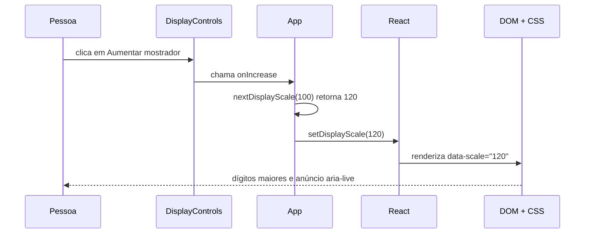

# Guia de engenharia do seocron

Este guia foi escrito para ser lido com o projeto aberto ao lado. A ideia não é decorar React: é seguir decisões reais no código, entender por que foram tomadas e reconhecer onde os mesmos conceitos aparecem em outros produtos.

## Uma ordem de leitura que não assusta

1. Abra [`src/main.tsx`](../src/main.tsx). É o ponto em que React entra na página.
2. Vá para [`src/App.tsx`](../src/App.tsx). Ele coordena os modos e recursos compartilhados.
3. Leia [`src/features/timer/useTimer.ts`](../src/features/timer/useTimer.ts). Aqui está a regra principal do Timer.
4. Compare com [`src/features/stopwatch/useStopwatch.ts`](../src/features/stopwatch/useStopwatch.ts).
5. Veja como os dados chegam à tela em [`TimerPanel.tsx`](../src/features/timer/TimerPanel.tsx), [`StopwatchPanel.tsx`](../src/features/stopwatch/StopwatchPanel.tsx) e [`TimeDisplay.tsx`](../src/components/TimeDisplay.tsx).
6. Abra [`DisplayControls.tsx`](../src/components/DisplayControls.tsx) e [`display-scale.ts`](../src/features/display/display-scale.ts).
7. Estude uma integração do navegador em [`useFullscreen.ts`](../src/hooks/useFullscreen.ts) e depois a versão mais cuidadosa em [`useWakeLock.ts`](../src/hooks/useWakeLock.ts).
8. Leia os testes ao lado de cada arquivo. Termine com [`e2e/platform.spec.ts`](../e2e/platform.spec.ts) e [`.github/workflows/ci.yml`](../.github/workflows/ci.yml).

Não tente entender todo o CSS de uma vez. Procure no [`src/index.css`](../src/index.css) apenas a classe ou o atributo que apareceu no componente que você está lendo.

## Vocabulário mínimo

### State

**State** é a memória atual de uma interface React. Em `App`, `displayScale` começa em `100` e `isFocusMode` começa em `false`. Quando o state muda, React renderiza novamente o que depende dele.

State não significa persistência. Como nenhum valor é copiado para Web Storage ou servidor, essa memória desaparece ao recarregar a página.

### Props

**Props** são dados e funções enviados de um componente pai para um filho. `App` monta `displayControls` e passa essa prop para os dois painéis. Assim, Timer e Cronômetro usam o mesmo estado de escala e foco sem duplicá-lo.

Uma forma simples de pensar: state é “o que o componente sabe”; props são “o que ele recebeu”.

### Hook

Um **hook** é uma função React que encapsula state, efeitos ou uma regra reutilizável. `useTimer` oferece `start`, `pause`, `reset` e `remainingMs`. O componente não precisa saber como cada cálculo interno funciona.

### Effect

Um **effect** sincroniza React com algo externo à renderização: um evento do `document`, o título da aba, um intervalo ou uma API do navegador. Effects devem ser usados para sincronização, não para cálculos que poderiam acontecer diretamente.

### Evento e callback

Um **evento** é algo que aconteceu: clique, tecla, `fullscreenchange`, mudança de visibilidade. Um **callback** é uma função entregue para ser chamada quando isso acontecer. `onToggleFocus` é um callback.

### Cleanup

**Cleanup** é a limpeza executada quando um effect deixa de valer ou o componente desmonta. Remover listeners e cancelar intervalos evita eventos duplicados, vazamentos e atualizações em uma tela que já não existe.

### Fallback

**Fallback** é um comportamento seguro quando a opção ideal não está disponível. Se fullscreen ou Wake Lock não forem suportados, a contagem continua correta. O recurso melhora a experiência, mas não vira requisito para o produto funcionar.

### Artefato

Um **artefato** é um arquivo produzido pelo processo, não o código-fonte em si. Exemplos: relatório de cobertura, resultado do Lighthouse, trace do Playwright e pasta `dist/`.

### Quality gate

Um **quality gate** é uma regra automática que precisa passar antes do merge. Ele transforma “parece bom” em uma condição repetível, como “branches cobertos em pelo menos 80%” ou “CSS abaixo de 15 KB gzip”.

## Siga um clique de ponta a ponta

Vamos acompanhar o clique em **Aumentar mostrador**.



1. Em [`DisplayControls.tsx`](../src/components/DisplayControls.tsx), procure o botão com `aria-label="Aumentar mostrador"`.
2. Seu `onClick` chama a prop `onIncrease`.
3. Em [`App.tsx`](../src/App.tsx), `onIncrease` aponta para `increaseDisplay`.
4. A função chama `nextDisplayScale(displayScale)` e atualiza o state.
5. O tipo `DisplayScale`, em [`display-scale.ts`](../src/features/display/display-scale.ts), permite somente `80 | 100 | 120 | 140`. Nos limites, as funções devolvem o próprio limite.
6. `TimeDisplay` recebe a escala e escreve `data-scale` no DOM.
7. O [`index.css`](../src/index.css) seleciona esse atributo e altera `font-size` e espaço. Não usa `zoom` nem `transform: scale`, então o layout realmente reserva o novo tamanho.
8. `setLiveMessage` escreve “Mostrador em 120%” na região `aria-live` de `App`.
9. [`display-scale.test.ts`](../src/features/display/display-scale.test.ts) prova os limites; [`DisplayControls.test.tsx`](../src/components/DisplayControls.test.tsx) prova rótulos e botões desabilitados; [`platform.spec.ts`](../e2e/platform.spec.ts) prova persistência entre modos, reset no reload e ausência de overflow.

Esse caminho — evento → callback → state → render → DOM/CSS → teste — aparece em filtros, carrinhos, menus, formulários e quase qualquer interface React.

## Por que o intervalo não é um relógio

Parece natural diminuir um número a cada segundo:

```ts
// Ideia frágil: presume que cada tick chegou na hora certa.
setInterval(() => setSeconds((value) => value - 1), 1_000)
```

O navegador não promete essa precisão. Ele pode atrasar callbacks para poupar bateria, priorizar a aba visível ou lidar com uma máquina ocupada. Depois de sessenta atrasos pequenos, o erro já pode ser perceptível.

O seocron separa duas responsabilidades:

- [`useNow`](../src/hooks/useNow.ts) solicita renderizações periódicas;
- `Date.now()` informa o tempo real usado no cálculo.

No Timer, `useTimer` guarda `endsAtMs`. Enquanto roda, o restante é `endsAtMs - now`. Ao pausar, essa diferença vira `pausedRemainingMs`. No Cronômetro, `useStopwatch` soma o tempo já acumulado à diferença `now - startedAtMs`.

Se a aba dormir por trinta segundos, nenhum tick precisa ser recuperado. Na próxima renderização, a diferença entre timestamps já inclui os trinta segundos.

O trade-off é que `Date.now()` acompanha o relógio do sistema e pode saltar se a hora do computador for alterada. `performance.now()` é monotônico, mas não sobrevive da mesma forma a todos os ciclos e exigiria outro modelo para retomar estados. Para um Timer efêmero no navegador, `Date.now()` oferece a relação mais simples entre correção, teste e manutenção.

## Timer e Cronômetro: parecidos, mas não iguais

`useTimer` usa uma pequena máquina de estados: `idle`, `running`, `paused` e `completed`. A transição explícita evita combinações impossíveis, como “concluído e ainda com timestamp de término”. `normalizeDuration` também impede valores infinitos, fracionários inadequados ou fora do limite.

`useStopwatch` não precisa de `completed`, mas guarda `accumulatedMs`, `startedAtMs` e `laps`. Cada volta registra:

- `elapsedMs`: total desde o início;
- `splitMs`: diferença desde a volta anterior.

Separar os hooks impede que regras diferentes virem um grande componente cheio de condicionais. Ao mesmo tempo, não foi criada uma abstração genérica de “motor temporal”: os dois fluxos ainda são pequenos e uma generalização poderia esconder mais do que ajuda.

## Foco, escala e fullscreen

### Escala

O tipo união `DisplayScale` impede valores arbitrários. Isso reduz casos de teste e torna possível garantir que todas as combinações cabem em 320 px. A escala é compartilhada porque fica em `App`, acima dos dois modos.

Ela altera apenas o mostrador. Aplicar zoom na página ampliaria controles, poderia criar scroll e interferiria no zoom escolhido pela própria pessoa no navegador.

### Modo foco

`isFocusMode` decide o que React renderiza. No foco, cabeçalho, troca de modo, presets, formulário, aparência e lista de voltas somem; status, mostrador, visualização e ações essenciais permanecem.

“Sumir” aqui não significa apagar state. As voltas continuam dentro de `useStopwatch` e reaparecem quando o painel volta a renderizar a lista. Essa distinção é importante: **visibilidade é apresentação; existência do dado é estado**.

### Fullscreen

[`useFullscreen`](../src/hooks/useFullscreen.ts) encapsula uma API imperativa do navegador:

- detecta suporte antes de oferecer a ação;
- solicita fullscreen em `document.documentElement`;
- escuta `fullscreenchange`, inclusive quando `Esc` encerra o modo;
- captura rejeições, pois permissões e contexto do navegador podem bloquear a solicitação;
- remove o listener no cleanup.

Foco e fullscreen são independentes. Essa composição é mais flexível: fullscreen pode mostrar a interface completa, e foco pode funcionar mesmo quando fullscreen é bloqueado.

Os testes de [`useFullscreen.test.ts`](../src/hooks/useFullscreen.test.ts) simulam suporte, entrada, saída, `Esc`, erro e cleanup. O E2E aceita o fallback porque engines headless e plataformas diferem no suporte real.

## Fontes locais, temas e favicon

As seis opções de fonte são definidas em [`themes.ts`](../src/features/appearance/themes.ts). JetBrains Mono, Space Mono, IBM Plex Mono, Orbitron e VT323 vêm de pacotes Fontsource; DSEG7 vem do pacote DSEG. Os imports em [`index.css`](../src/index.css) entram no build do Vite, então o navegador não consulta Google Fonts ou CDN.

IBM Plex Mono pode ser usada na interface e no mostrador. Orbitron é aplicada ao mostrador, enquanto os controles permanecem com uma fonte monoespaçada legível. Essa separação evita sacrificar leitura em textos menores por uma estética mais forte nos dígitos.

Os temas usam tokens semânticos como `--background`, `--text-primary` e `--accent`. Um componente pede “cor de texto principal”, não “azul específico”. Isso facilita trocar paletas e testar contraste de forma centralizada.

O favicon possui SVG para nitidez, PNG de 32 px como fallback e ícone de 180 px para dispositivos Apple. Não existe manifest porque instalar o app e controlar cache são decisões de PWA maiores do que apenas fornecer um ícone.

## Wake Lock sem tornar o app frágil

[`useWakeLock`](../src/hooks/useWakeLock.ts) recebe `activeRunning`. Portanto, ele só tenta manter a tela acordada quando Timer ou Cronômetro está rodando.

O hook verifica suporte, solicita o lock apenas com documento visível, evita pedidos duplicados, tenta novamente ao voltar para a aba e libera o sentinel no cleanup. Todos os erros são capturados porque Wake Lock é uma melhoria, não a fonte da contagem.

Esse padrão serve para geolocalização, clipboard, notificações e outras APIs opcionais: detecte capacidade, limite o efeito, trate rejeição e preserve a função central.

## Testes: cada camada responde uma pergunta

- **Testes puros:** funções de duração, formatação, contraste e escala retornam o resultado certo?
- **Testes de hooks:** transições de tempo e integrações do navegador funcionam com relógio e APIs simulados?
- **Testes de componentes:** a pessoa encontra nomes acessíveis, limites e conteúdo correto?
- **Axe:** a árvore renderizada contém violações automáticas conhecidas?
- **E2E:** os fluxos reais funcionam em Chromium, Firefox e WebKit, inclusive em 320 px?
- **Smoke de produção:** o deploy real carrega e executa os dois modos principais?

Teste determinístico é aquele que controla relógio, evento e entrada em vez de depender de “esperar mais ou menos”. Os hooks de tempo usam fake timers nos testes; E2E usa pequenas esperas apenas para provar que o valor real mudou.

Cobertura não mede qualidade sozinha. Ela mostra caminhos que nunca foram executados e aplica um piso, mas não diz se as asserções são úteis. Por isso convive com testes de comportamento, Axe, Lighthouse, orçamentos e revisão visual.

## CI/CD sem mistério

**CI** é a verificação automática de cada mudança. **CD**, neste projeto, é entregar previews por PR e publicar a `main` aprovada.

Em [`.github/workflows/ci.yml`](../.github/workflows/ci.yml), os jobs rodam em paralelo:

1. `Verify` valida formatação, TypeScript, lint, testes, build e orçamento.
2. `E2E` usa uma matriz para repetir os mesmos fluxos em três engines.
3. `Quality Metrics` mede cobertura, bundle e três rodadas do Lighthouse.

Falhas E2E guardam trace, screenshot e relatório por sete dias. Esses artefatos permitem investigar depois que a máquina efêmera da CI desaparece.

A Vercel cria um preview para o PR. A proteção da `main` exige branch atualizada, checks e preview verdes, conversas resolvidas e histórico linear. O squash transforma o conjunto revisado em um commit claro; a branch curta é removida depois do merge.

Após produção, [`production-smoke.yml`](../.github/workflows/production-smoke.yml) testa a URL publicada. Essa etapa captura problemas que um build local não vê, como deploy vazio ou arquivo indisponível.

## O que pode falhar e como pensar

| Falha                       | Comportamento esperado                            | Onde investigar                      |
| --------------------------- | ------------------------------------------------- | ------------------------------------ |
| Aba suspensa                | timestamp corrige o valor ao voltar               | `useNow`, `useTimer`, `useStopwatch` |
| Fullscreen bloqueado        | mensagem acessível; Timer continua                | `useFullscreen`, `App`               |
| Wake Lock ausente           | tela pode dormir; contagem continua correta       | `useWakeLock`                        |
| Fonte demora a carregar     | fallback monoespaçado evita texto invisível       | imports e `font-family` no CSS       |
| 140% em 320 px              | CSS reduz tamanhos responsivamente, sem cortar    | `data-scale`, media queries, E2E     |
| E2E falha só na CI          | trace e screenshot preservam contexto             | artefatos do job E2E                 |
| Lighthouse oscila           | três rodadas reduzem ruído; bundle é gate estável | script de Lighthouse e orçamento     |
| Deploy passou, app não abre | smoke de produção falha                           | workflow de smoke e Vercel           |

Uma boa investigação começa separando **sintoma**, **fonte da verdade** e **efeito opcional**. Exemplo: a tela dormir é um problema de Wake Lock; o tempo calculado errado seria um problema do motor. Misturar os dois levaria a um conserto no lugar errado.

## Trade-offs e alternativas rejeitadas

- **Sem store global:** React state e props bastam; uma biblioteca adicionaria API e manutenção sem reduzir complexidade atual.
- **Sem persistência:** recarregar perde preferências, mas preserva a promessa de zero armazenamento e simplifica privacidade.
- **Sem backend:** não há dado para sincronizar nem regra secreta para executar.
- **Sem logs remotos:** CI, deploy e artefatos observam o sistema sem observar pessoas.
- **Sem PWA agora:** service worker exige política de atualização e cache; o favicon sozinho não justifica esse risco.
- **Sem escala contínua:** quatro valores permitem layout, acessibilidade e testes previsíveis.
- **Sem abstração única para os dois motores:** duplicação pequena e explícita é mais legível do que uma generalização prematura.

Trade-off não significa que uma opção é universalmente ruim. Significa que, dadas as necessidades atuais, o custo supera o valor.

## Como levar isso para outros produtos

- Timestamps em vez de ticks servem para expiração de sessão, cooldown, leilão e progresso que precisa sobreviver a abas suspensas.
- Hooks de capacidade servem para câmera, geolocalização, clipboard e compartilhamento nativo.
- Tipos união como `DisplayScale` servem para status de pedido, papéis de usuário e etapas de fluxo.
- Tokens semânticos servem para dark mode, white-label e acessibilidade.
- Estado acima de irmãos serve para filtros compartilhados entre tabela e gráfico.
- Quality gates e orçamento de bundle servem para impedir regressões silenciosas em qualquer frontend.
- Smoke pós-deploy serve para APIs, sites estáticos e aplicações com backend.

## O que demonstra maturidade em entrevista

Em vez de dizer apenas “fiz um cronômetro”, explique decisões:

- “Intervalos só agendam render; timestamps são a fonte real do tempo.”
- “APIs opcionais possuem detecção, fallback, tratamento de rejeição e cleanup.”
- “Escolhi não criar backend porque o produto não possui responsabilidade de servidor.”
- “Qualidade combina testes determinísticos, três engines, acessibilidade, cobertura, bundle e smoke real.”
- “Escala, foco e fullscreen são estados independentes porque resolvem necessidades diferentes.”
- “Observabilidade ficou na entrega para não transformar métricas técnicas em coleta de usuários.”

O valor não está em citar ferramentas. Está em conectar requisito, risco, decisão e evidência.

## Exercícios seguros

Faça um por branch e escreva primeiro o teste mais próximo:

1. Adicione uma escala de 110%. Descubra por que isso altera tipo, botões, CSS e E2E — depois reverta ou decida se vale manter.
2. Crie um atalho `F` para foco, ignorando campos interativos como os atalhos atuais.
3. Adicione um teste que prove que trocar de modo pausa uma contagem ativa.
4. Mostre uma mensagem visual não intrusiva quando fullscreen falhar, preservando `aria-live`.
5. Crie um tema em uma branch e execute os testes de contraste antes de ajustar cores.
6. Quebre temporariamente o limite de CSS, rode `npm run quality:budget` e leia a falha.
7. Simule `Date.now()` avançando cinco minutos sem executar cinco minutos de ticks e observe o Timer concluir.
8. Leia um trace do Playwright de uma falha criada de propósito; não faça commit da falha.

Ao terminar cada exercício, responda: qual era a fonte da verdade, qual camada mudou, qual teste prova o resultado e qual risco novo apareceu?

## Próximos mapas

- Para visão de produto e limites: [PROJECT_CONTEXT.md](./PROJECT_CONTEXT.md).
- Para ideias priorizadas e critérios: [BACKLOG.md](./BACKLOG.md).
- Para comandos rápidos e screenshots: [README.md](../README.md).
