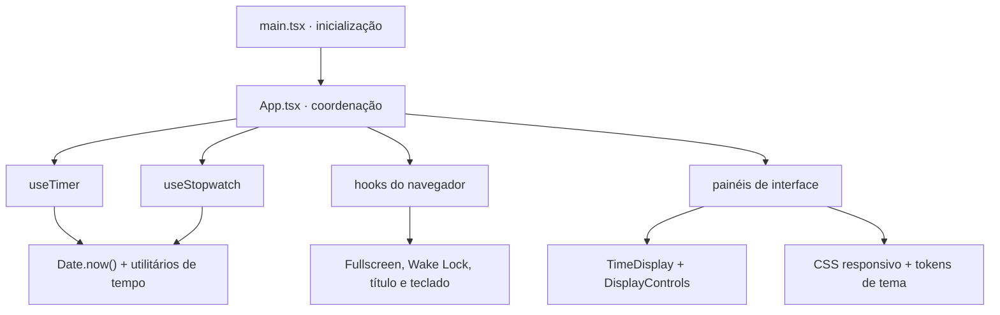

# Contexto do projeto

## Em uma frase

O **seocron** é um Timer + Cronômetro rápido, acessível e privado que funciona inteiramente no navegador.

Ele resolve um problema pequeno de propósito: acompanhar tempo sem conta, configuração demorada, anúncios ou coleta de comportamento. Essa restrição também orienta a engenharia. O projeto não tenta parecer complexo adicionando peças que não ajudam o produto.

## Público e necessidades

O público principal é quem precisa deixar um tempo visível enquanto estuda, trabalha, apresenta ou pratica uma atividade. Essas pessoas precisam de:

- leitura rápida, inclusive de longe e em telas pequenas;
- operação por mouse, toque ou teclado;
- Timer e Cronômetro no mesmo lugar;
- resistência à suspensão de abas e atrasos do navegador;
- controle visual sem perder privacidade;
- comportamento previsível quando uma API do navegador não existe.

Não há conta, sincronização ou histórico entre sessões. Recarregar a página restaura tema, fonte e escala aos padrões e apaga voltas e contagens em andamento. Isso é comportamento intencional, não perda acidental de dados.

## Limites do produto

O aplicativo é uma SPA estática e client-only. Em produção, a Vercel entrega HTML, CSS, JavaScript, fontes e ícones; depois do carregamento, o seocron não precisa de um servidor de aplicação.

Invariantes que não devem ser quebradas sem uma decisão explícita de produto:

- não adicionar backend, conta ou banco de dados;
- não adicionar analytics, tracking, cookies ou logs remotos;
- não usar `localStorage`, `sessionStorage` ou IndexedDB;
- não fazer requisições externas em runtime;
- servir fontes e ícones pelo mesmo host;
- obter o tempo real por `Date.now()`, nunca contando execuções de intervalo;
- pedir Wake Lock somente enquanto o modo ativo está rodando;
- manter controles acessíveis por teclado e temas com contraste WCAG AA.

## Arquitetura

- [`src/App.tsx`](../src/App.tsx) concentra a coordenação atual. Uma pasta `src/app` só faria sentido quando essa composição realmente precisasse ser dividida.
- [`src/features/timer`](../src/features/timer) e [`src/features/stopwatch`](../src/features/stopwatch) separam regra de tempo e apresentação.
- [`src/features/appearance`](../src/features/appearance) mantém tema e fonte apenas em state React.
- [`src/features/display`](../src/features/display) define as escalas permitidas e seus limites.
- [`src/hooks`](../src/hooks) isola APIs e eventos do navegador.
- [`src/lib/time`](../src/lib/time) contém parsing, limites e formatação sem depender de React.
- [`src/test`](../src/test) e [`e2e`](../e2e) cobrem integração, acessibilidade e fluxos reais.

## Fluxo de dados

O fluxo é propositalmente unidirecional:

1. Uma pessoa aciona um botão.
2. O evento chama uma função no painel ou em `App`.
3. Um hook atualiza o state.
4. React renderiza uma nova descrição da interface.
5. O navegador atualiza o DOM e aplica o CSS.
6. Quando necessário, a região `aria-live` anuncia a mudança ao leitor de tela.

Timer e Cronômetro possuem controladores próprios. `App` conhece os dois para coordenar troca de modo, atalhos, Wake Lock, título, foco, escala e fullscreen. A interface recebe dados e callbacks por props; não há store global porque o tamanho atual não justifica esse custo.

## Decisões relevantes

### Timestamps são a fonte do tempo

Um `setInterval` pode atrasar quando a aba fica em segundo plano. Por isso, [`useNow`](../src/hooks/useNow.ts) apenas pede uma nova renderização. O Timer guarda quando deve terminar; o Cronômetro guarda quando começou e quanto já acumulou. A diferença entre timestamps produz o valor correto quando a aba volta.

### Foco, escala e fullscreen são estados independentes

O modo foco esconde partes não essenciais. A escala altera só a tipografia e o espaço do mostrador. Fullscreen usa a API do navegador e ocupa a tela com a aplicação inteira. Sair de um não encerra os outros. Os três estados vivem somente durante a sessão da página.

### Integrações de navegador ficam em hooks

[`useFullscreen`](../src/hooks/useFullscreen.ts), [`useWakeLock`](../src/hooks/useWakeLock.ts), [`useDocumentTitle`](../src/hooks/useDocumentTitle.ts) e [`useKeyboardShortcuts`](../src/hooks/useKeyboardShortcuts.ts) mantêm efeitos, fallbacks e cleanup longe dos componentes visuais. Isso reduz efeitos escondidos e facilita testes determinísticos.

### Observabilidade proporcional

Não existem logs ou métricas de usuários em produção. Para um aplicativo estático sem servidor, isso criaria coleta, custo e obrigações de privacidade sem resolver um problema atual. A observabilidade útil está no processo de entrega: logs da CI e da Vercel, relatórios de cobertura e Lighthouse, tamanhos do build e traces/screenshots quando um E2E falha.

### Entrega em branches curtas

O fluxo recomendado é branch curta → pull request → preview Vercel → checks obrigatórios → squash merge na `main`. A `main` permanece publicável. Git Flow e branches permanentes de release adicionariam coordenação sem benefício para este ritmo e tamanho de equipe.

## Qualidade e operação

Cada PR executa três grupos independentes:

- **Verify:** formatação, tipos, lint, testes e build;
- **E2E:** fluxos em Chromium, Firefox e WebKit;
- **Quality Metrics:** cobertura, orçamento do build e três medições do Lighthouse.

Os mínimos atuais são 85% para linhas/statements, 80% para funções/branches, 100% em acessibilidade, 95% em boas práticas e 90% em SEO. JavaScript pode ocupar até 90 KB gzip, CSS até 15 KB gzip e fontes locais até 400 KB sem compressão. Performance abaixo de 90% gera aviso; o orçamento de bundle é o gate mais estável.

Após um deploy de produção, [`production-smoke.yml`](../.github/workflows/production-smoke.yml) abre a URL real e confirma carregamento, Timer e Cronômetro. Isso verifica a entrega sem transformar E2E completo em monitor de produção.

## Fora do escopo atual

Contas, tracking, histórico persistente, logs remotos e backend não estão planejados. PWA, alertas locais e configuração por URL podem fazer sentido, mas exigem decisões próprias e estão registrados no [backlog](./BACKLOG.md).

Para estudar como essas decisões aparecem no código, continue pelo [Guia de engenharia](./GUIA_DE_ENGENHARIA.md).
